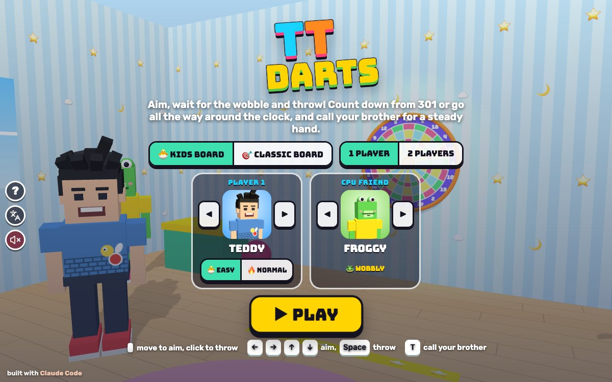

# TT Darts

[](https://adong.github.io/darts-tt/)

Press **?** any time (or tap the round **?** button on the left edge) to see the keys. The game waits while you look.
Tap the language button under it (the A文 icon) to switch between English and 中文; the dashboard and every game remember the choice.

**中文：** 飞镖游戏：瞄准靶，看准晃动的时机扔飞镖，玩 301 或数字转一圈，还可以叫兄弟来帮你稳住手。

A darts game starring Teddy and Tommy. Aim at the board, watch your aim wobble, and throw when it's on your number. There are two boards, a big soft one with suction-cup darts in a playroom (KIDS BOARD) and a real dartboard in a games room (CLASSIC BOARD), and two games, 301 and Around the Clock, for 1 player (against a CPU friend, or alone) or 2 taking turns. It's built with Claude Code from plain JavaScript and Three.js, in the same style as Metro Surfer and the other Teddy & Tommy games. There are no image, model or audio files: the rooms, boards and darts are boxes, cylinders and canvas-painted textures, the characters come from the shared kit (`kit/`), and every sound is synthesised.

The name lives in one place, [js/title.js](js/title.js). "TT Darts" is a working title until Alan names it.

## Play

- **Double-click `index.html`.** It works offline, because Three.js and the kit are copied into `kit/`. Without internet the logo falls back from the Bungee font to Arial Black.
- **Send one file:** `dist/darts-tt.html` is the whole game in one file. AirDrop or email it, then open it in a browser.
- **Rebuild that file** after any edit: `python3 kit/tools/bundle.py . --name darts-tt`
- **Get kit updates** from `~/claude-games/kit`: `python3 ../kit/tools/sync.py .`, then rebuild.
- **Saved per browser:** the board, 1 or 2 players, who's playing, each player's EASY / NORMAL, the CPU friend, the last game, each player's best (fewest darts) per board, game and level, and everyone's wins. `index.html` and `dist/darts-tt.html` each keep their own, because they're different ways of opening the game.

### How hard

Each player picks his own level, so Tommy on EASY can play Teddy on NORMAL.

| | 🐣 EASY (for Tommy, the default) | 🔥 NORMAL (for Teddy) |
|---|---|---|
| the wobble | small and slow | bigger and faster |
| the aim | glides to the bull (301) or to your number (Around the Clock) before each dart | stays where you left it |
| 301 | reach 0 or go past it and you win: no busts | the real rules: finish exactly on 0 with a double or the bullseye; going past 0, leaving 1, or reaching 0 any other way is a BUST and the turn goes back |
| help | your number glows in Around the Clock | the same, and in 301 the double you need to finish glows, with "YOU NEED 32: GO FOR DOUBLE 16!" |

## The boards

- **🐣 KIDS BOARD:** a big soft board (about 1 m across) with fat treble and double rings, a big bull with a star, white numbers on a purple ring, and chunky suction-cup darts that go "thwop" and wobble when they stick. A playroom with striped wallpaper, a rug, a toy chest, balls and a star-tape throwing line.
- **🎯 CLASSIC BOARD:** a regulation board (340 mm across the doubles, bull 12.7 mm, 25 ring 31.8 mm, trebles 99–107 mm, doubles 162–170 mm from the middle), black and cream with red and green rings and silver wires, in a wooden cabinet with its doors open, under a lamp. Steel darts with a point, a barrel, a shaft and flights.

Both boards use the real number order (20 at the top, then 1, 18, 4, 13, 6, 10, 15, 2, 17, 3, 19, 7, 16, 8, 11, 14, 9, 12, 5). The picture is painted from the same ring sizes the scoring uses, and a check makes sure they match.

## The games

- **301:** everyone starts on 301. Three darts a turn; each dart takes its points off. Doubles score twice, trebles three times, the 25 ring 25 and the bullseye 50. 100 or more in a turn gets a big cheer. On NORMAL you must finish on a double (or the bullseye).
- **Around the Clock (数字转一圈):** hit 1, then 2, then 3 … all the way to 20, then the bull (either bull finishes). Your number glows. Hit its double to jump 2 numbers, its treble to jump 3.
- **Turns:** in 2 players, or against a CPU friend, the thrower walks up to the line and the others wait to the side. After three darts (or a BUST) the darts come out of the board and it's the next player's go.
- **The CPU friends:** 🦊 Foxy is steady and goes for the treble 20; 🐸 Froggy wobbles more and goes for the big 20. Both take a checkout when there is one. You watch their aim slide in before they throw. Or pick NO ONE to play alone and beat your best.
- **The end:** the winner turns round and does his signature move (Teddy's boxing or his jump shot with a 🏀, taking turns; Tommy's Y with peace fingers; Foxy waves, Froggy hops) with confetti. Then the card: who reached what, how many darts, NEW BEST!, each player's best, and the wins so far. PLAY AGAIN or PICK A GAME.

## Controls

| | Keys | Mouse | Touch |
|---|---|---|---|
| aim | ← → ↑ ↓ | move over the board | slide your finger anywhere (it moves the aim like a trackpad, so your finger never hides the board) |
| throw | Space or Enter | click | let go (a quick tap throws too) |
| call your brother (2 players: high five) | T | his face, bottom right | his face, bottom right |
| pause | P or Esc | ❚❚ | ❚❚ |
| sound on / off | M | 🔊 | 🔊 |
| on the title | ← → player 1, E easy / normal, C kids or classic board, 1 / 2 players, Enter play | | |
| pick a game | 1 or ← 301, 2 or → Around the Clock | | |

The bottom left shows this turn's three darts (T20, 5, MISS...) and their total, or your Around the Clock number. The top left shows everyone's score (or number) and the darts left this turn.

## Companion

Call your brother any time, as often as you like: **T**, or tap his face (bottom right). Teddy's brother is Tommy, Tommy's is Teddy (`Kit.roster.buddyFor`).

- The camera turns round: he pops in beside you at his buddy size, does his signature move (Tommy's Y ✌️, Teddy's boxing or jump shot) and tosses you a treat (🍦 💧 🧃 🍪 🍉 🍌).
- Then he **steadies your aim**: he holds your arm, the aim ring turns gold, and the wobble shrinks to a quarter for the rest of your turn: "TOMMY SAYS: I'VE GOT YOUR ARM! NICE AND STEADY!"
- Call him while it's not your go (the CPU's turn, or while the darts come out) and he steadies your next go instead: "I'LL STEADY YOUR NEXT GO!"
- When your turn ends he says bye and pops out. Call him again next turn.
- When Teddy and Tommy are both playing, T is a high five instead: the camera turns round and the waiting brother runs over.

## How it was checked

- **`node tools/check.js`** (about 0.1 s, no browser), on the same `js/rules.js` the page uses:
  - **zones:** 808 points on both boards: the middle of every number's inner single, treble, outer single and double; both sides of every wire between two numbers at three radii; just inside and just outside every ring edge along every number; the bullseye, the 25 ring and their edges; just off the doubles and off the board.
  - **301:** 22 hand-written turns with the score each should leave (T20 T20 T20 from 301 leaves 121; 32 then D16 wins on NORMAL; 16 16 from 32 is a BUST back to 32; 20 20 T20 from 60 busts and the first two darts go back too; 1 from 2 leaves 1 and busts; the bullseye finishes 50 but the 25 ring doesn't finish 25; on EASY going past 0 wins), plus every checkout the game suggests really finishing.
  - **Around the Clock:** in order, the wrong number does nothing, a double jumps 2, a treble 3, never past the bull, the bull before 20 does nothing, either bull wins.
  - **CPU games:** 960 seeded games (both boards, both levels, both games, Foxy and Froggy): every one ends, the score never goes below 0, every NORMAL win is exactly 0 on a double, every EASY win is at 0 or past it, and every bust puts the whole turn back.
  - **The checks can fail:** the same checks run again with the board's numbers turned one place (720 zones wrong) and with 301 sabotaged (a bust that doesn't go back, a finish without a double: 6 cases and 4 game sets wrong). `node tools/check.js --fail` runs the sabotaged ones as if they were real and must report FAIL.
- **`game.check()` in the page** runs all of that plus: a dart at the middle of every zone on both boards through the game's own throw (aim + wobble), the same points through the screen and back (the mouse's path), and the painted board sampled just inside and outside every ring edge along every number to prove the picture matches the scoring (a board painted with trebles 10 % small fails 90 samples).
- **In headless Chrome** (`tools/shoot.js`, muted), from `file://`: whole games of 301 and Around the Clock on both boards, against Froggy and Foxy and 2 players; a real mouse move and click, a finger swipe, the arrow keys and Space; M and the 🔊 / 🔇 button; P / Esc pause (time stands still); the brother from T and from his face button, called again and again, during your go and during the CPU's, with the wobble going from 0.13 to 0.03; the high five; the win, the card and NEW BEST. No page errors.
- **Layouts:** phone upright (390x844), phone on its side (740x360), iPad (1024x768 and 820x1180): the board stays clear of the kit's round buttons on the left edge (its edge is always 60 px or more in), and the turn box, the brother's button and the HUD don't cover the board; the results card fits on a phone on its side.
- **中文:** with `Kit.lang.set('zh')`, the title, both games, the HUD, the brother's toasts, BUST, the win, the card, pause and the ? panel all give `Kit.lang.untranslated()` = [] (and it does catch English: a test label showed up in it). In English nothing on the page is Chinese except the language button's own tooltip, which names the language it switches to.

## Files

```
index.html          the page: HUD, title, game picker, pause, results card, the icon
js/title.js         the game's name, in one place
js/rules.js         the two boards, scoring zones, 301 and its checkout, Around the Clock, the wobble, the CPU
                    friends' aim. No Three.js, so it also runs in Node
js/checks.js        the headless checks (game.check() in the page, tools/check.js in Node)
js/friends.js       Foxy and Froggy (copied from TT Bowling)
js/sfx.js           whoosh, thwop / thunk, bull, treble, BUST, pulling the darts, cheers... on Kit.sound.tone / hiss
js/scene.js         the playroom and the games room, the painted boards, the glow on your number, the cameras
js/props.js         darts (in your hand, flying, stuck, dropped), the aim ring and wobble, people, treats, confetti
js/buddy.js         the brother: popping in, his treat, steadying your aim, saying bye
js/game.js          the title, the games, turns, aiming and throwing, the CPU, HUD, the win, the card, window.game
js/keys.js          the keys the ? panel shows (Kit.help)
js/zh.js            中文 (Kit.lang); names and the logo stay English
tools/check.js      the headless checks in Node
tools/shoot.js      headless Chrome screenshots and page tests (from TT Gomoku and TT Bowling)
tools/shots.json    the steps for docs/screenshot.jpg
kit/                copy of ~/claude-games/kit; edit the kit there, not here
dist/darts-tt.html  the single-file build
```

## Not verified

- **Sound:** every effect and the music run through Web Audio without errors (tested muted), but nobody has listened to them yet.
- **Real touch devices:** touch uses the same pointer events as the mouse, tested with synthetic finger swipes in phone and iPad sizes. It hasn't been tried with fingers on a real iPad or phone, or in iOS Safari; how far a slide moves the aim may need tuning.
- **A real double-click:** the page uses only classic `<script src>` tags and no fetches. Both `index.html` and `dist/darts-tt.html` boot to the title from `file://` in headless Chrome, but nobody has double-clicked them in Safari or Chrome on the Mac or iPad yet.
- **Real kids:** whether the EASY wobble is small enough for Tommy, whether NORMAL's double-out is fair for Teddy, and whether Foxy and Froggy are good matches.
- **The home-screen icon** on a real iPad.
